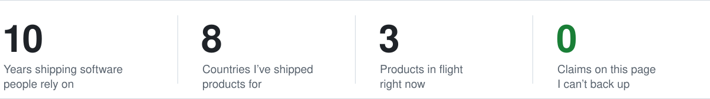

  

  <a href="https://www.upwork.com/services/consultation/development-it-bimasha-1564428339068612608"><b>Book a consultation</b></a>
  &nbsp;&nbsp;·&nbsp;&nbsp;
  <a href="#selected-work">Selected work</a>
  &nbsp;&nbsp;·&nbsp;&nbsp;
  <a href="https://www.linkedin.com/in/bimasha-zaman">LinkedIn</a>
  &nbsp;&nbsp;·&nbsp;&nbsp;
  <a href="mailto:bimashazaman1234@gmail.com">Email</a>

 

I help founders and product teams turn AI ideas into software people trust and pay for. Plenty of AI features look great in a demo, then fall apart once real customers use them. I've spent ten years building the parts of a business that can't break, like billing, scheduling, logins and APIs, and that's exactly the discipline AI needs now.

 

<picture>
  <source media="(prefers-color-scheme: dark)" srcset="./assets/proof-dark.svg">
  
</picture>

 

## Where I can help

<table>
<tr>
<td width="50%" valign="top">

**Your AI feature, finished** 
You have a prototype that wowed everyone, but it isn't safe to launch. I measure how often it's right, add alerts for when it isn't, and harden it until you can put it in front of paying customers.

structured outputs · evals · tracing · guardrails

</td>
<td width="50%" valign="top">

**Agents that give your team hours back** 
Automation that does real work in the background, inside the tools you already use. Hard limits, a sandbox and a human approval step wherever a mistake would cost money.

multistep agents · MCP · tool calling · approvals

</td>
</tr>
<tr>
<td width="50%" valign="top">

**AI that knows your business** 
Answers grounded in your own documents and data, with sources cited so people can check them. Retrieval quality gets measured, not guessed, and defended against prompt injection.

RAG · embeddings · hybrid search · citations

</td>
<td width="50%" valign="top">

**A product that doesn't break** 
Under every AI feature is an ordinary product that simply has to work. Payments, scheduling, logins and dashboards are what I've built for ten years, for real paying traffic.

Laravel · React · Next.js · Node · Stripe · real time

</td>
</tr>
</table>

 

## Selected work

<table>
<tr>
<td width="31%" valign="top">

CASE 01 
**Life Coach Hub**

Senior Full Stack Engineer United States · 2023 to now Laravel · React · Stripe

[lifecoachhub.com ↗](https://lifecoachhub.com)

</td>
<td valign="top">

**I keep a platform thousands of coaches rely on running smoothly, and ship new things without breaking the parts that handle their money.**

It's been live for years, so it carries old code, old decisions and a billing system where every bug has a dollar value attached. I work across the whole stack. I rebuilt the scheduling, billing and session credit logic, ran security audits, and tracked down the bugs that only show up in production payment flows.

I also changed how the team tests. AI tooling now drafts acceptance criteria and test plans for every release, so fewer surprises reach paying coaches.

</td>
</tr>
</table>

<table>
<tr>
<td width="31%" valign="top">

CASE 02 
**Bizam**

End to end engineering Live professional platform React · TypeScript · Node MongoDB · Redis

[bizam.net ↗](https://bizam.net)

</td>
<td valign="top">

**One engineer, a whole live product, and you can click through and use it today.**

Bizam puts jobs, freelance gigs, articles, messaging and a professional network in one account. I'm the engineering behind all of it: the React and TypeScript frontend, a modular Node and TypeScript API with background queues and real time messaging, MongoDB and Redis underneath, and automated deployments to DigitalOcean through GitHub Actions.

</td>
</tr>
</table>

<table>
<tr>
<td width="31%" valign="top">

CASE 03 
**A maintenance agent that runs every weekday**

Built on Bizam AI agents · test suites · GitHub · Jira

</td>
<td valign="top">

**Like having a careful senior engineer review your product every morning, without hiring one.**

Every weekday an agent pipeline I designed works through the Bizam codebase. It runs the tests, boots the app, hunts for real bugs, drafts fixes as pull requests on isolated branches, updates the Jira tickets and emails me a short briefing.

It can't run away with itself. Each run is capped at three pull requests and ten tickets, it works in a sandbox, and a person reviews every change before it merges. Autonomy where it's safe, human judgment where it matters.

</td>
</tr>
</table>

### More work

<table>
<tr>
<td width="31%" valign="top"><a href="https://evolov.com/"><b>Evolov ↗</b></a> MARKETPLACE · NORWAY</td>
<td valign="top">A marketplace platform, rebuilt with Next.js and Django.</td>
</tr>
<tr>
<td valign="top"><a href="https://app.admissionpedia.com/"><b>AdmissionPedia ↗</b></a> EDTECH · INDIA</td>
<td valign="top">Admissions platform for students and families, built with Next.js and Laravel.</td>
</tr>
<tr>
<td valign="top"><a href="https://www.pixground.com/"><b>Pixground ↗</b></a> CREATOR PLATFORM</td>
<td valign="top">Free 4K wallpapers and ringtones from creators, with high volume browsing and automated publishing.</td>
</tr>
<tr>
<td valign="top"><a href="https://iot-experience.vercel.app/"><b>IoT Experience ↗</b></a> ENTERPRISE IOT</td>
<td valign="top">Marketing site and device dashboard, built with Next.js and deployed on Vercel.</td>
</tr>
<tr>
<td valign="top"><a href="https://www.acetechlimited.net/"><b>AceTech Limited ↗</b></a> COMPANY WEBSITE</td>
<td valign="top">Website for a software and app development company, built as a fast static site with no build step and served by nginx.</td>
</tr>
<tr>
<td valign="top"><b>Keeprate</b> FOUNDER · PRELAUNCH</td>
<td valign="top">An AI app that helps Shopify merchants cut return rates. It works out why customers send things back, then fixes the causes upstream with better sizing guidance, listing copy and fit data.</td>
</tr>
</table>

 

## Ways to work together

<table>
<tr>
<td width="33%" valign="top">

**Fixed scope project** 
A clear deliverable, price and timeline agreed up front. Best when you know what you need: an AI feature finished, an agent shipped or a shaky product made solid.

</td>
<td width="33%" valign="top">

**Embedded with your team** 
Senior hands inside your team a few days a week, building alongside your engineers, reviewing code and quietly raising the bar on reliability.

</td>
<td width="33%" valign="top">

**Advisory and audits** 
A focused review or a single call to get you unstuck. Is the idea sound, is it safe to launch, and what would I do next? Short and honest.

</td>
</tr>
</table>

 

## How I work

**Business question first.** Before any code, we agree what this needs to do, in numbers.

**Risky part first.** I prototype the hardest piece early, so we find out cheaply whether the idea survives real data.

**Reliable from day one.** Testing, monitoring and security go in at the start instead of being bolted on at the end.

**No surprises.** You'll always know where things stand, because I overcommunicate on purpose.

 

## Stack

<table>
<tr>
<td width="26%" valign="top"><b>AI and agents</b></td>
<td>
&nbsp;&nbsp;&nbsp;
&nbsp;&nbsp;&nbsp;
&nbsp;&nbsp;&nbsp;
&nbsp;&nbsp;&nbsp;

 Claude, OpenAI, Gemini, MCP, LangGraph, Ollama, RAG, evals and observability
</td>
</tr>
<tr>
<td valign="top"><b>Frontend</b></td>
<td>
&nbsp;&nbsp;&nbsp;
&nbsp;&nbsp;&nbsp;
&nbsp;&nbsp;&nbsp;
&nbsp;&nbsp;&nbsp;
&nbsp;&nbsp;&nbsp;

 React, React Native, Next.js, TypeScript, JavaScript, Tailwind CSS, Vite
</td>
</tr>
<tr>
<td valign="top"><b>Backend</b></td>
<td>
&nbsp;&nbsp;&nbsp;
&nbsp;&nbsp;&nbsp;
&nbsp;&nbsp;&nbsp;
&nbsp;&nbsp;&nbsp;
&nbsp;&nbsp;&nbsp;
&nbsp;&nbsp;&nbsp;

 Laravel, PHP, Node.js, Express, Python, Django, Stripe, REST and GraphQL APIs
</td>
</tr>
<tr>
<td valign="top"><b>Data</b></td>
<td>
&nbsp;&nbsp;&nbsp;
&nbsp;&nbsp;&nbsp;
&nbsp;&nbsp;&nbsp;

 PostgreSQL, MySQL, MongoDB, Redis
</td>
</tr>
<tr>
<td valign="top"><b>Infrastructure</b></td>
<td>
&nbsp;&nbsp;&nbsp;
&nbsp;&nbsp;&nbsp;
&nbsp;&nbsp;&nbsp;
&nbsp;&nbsp;&nbsp;
&nbsp;&nbsp;&nbsp;

 AWS, DigitalOcean, Docker, Nginx, GitHub Actions, Vercel, Linux
</td>
</tr>
</table>

 

## Ten years, briefly

<table>
<tr>
<td width="18%" valign="top">2025 TO NOW</td>
<td valign="top"><b>Keeprate</b>, founder. My own AI product, built end to end. The strongest test of everything the last decade taught me.</td>
</tr>
<tr>
<td valign="top">NOW</td>
<td valign="top"><b>Bizam</b>, end to end engineering for a live platform, plus the agent pipeline that checks its code every weekday.</td>
</tr>
<tr>
<td valign="top">2023 TO NOW</td>
<td valign="top"><b>Life Coach Hub</b>, Senior Full Stack Engineer, United States. Modernizing a production platform that real businesses depend on.</td>
</tr>
<tr>
<td valign="top">2022 TO 2023</td>
<td valign="top"><b>The contract years.</b> Senior and lead roles with five product companies in fintech, marketplaces, edtech and gaming, across Finland, Norway, India and Armenia.</td>
</tr>
<tr>
<td valign="top">2015 TO 2022</td>
<td valign="top"><b>Freelance and early stage work</b> in Bangladesh, plus mentoring new developers through the Tech Expert community, which taught me to explain hard things simply.</td>
</tr>
</table>

 

## Questions people ask

<b>I'm not technical. Will I follow what you're saying?</b>

 
Every word. I explain things in plain English, whether that's what a database does or how an agent decides its next step. You bring the problem and I'll keep the jargon out of it.

<b>Can you work inside our existing codebase?</b>

 
That's most of my work. Life Coach Hub had years of history before I joined, and I've rebuilt core parts of it while it stayed live and taking payments.

<b>Which AI models do you use?</b>

 
Whichever fits the job. I build on Claude, OpenAI and Gemini, and choose between them on measured quality and cost rather than hype.

<b>What happens when something breaks?</b>

 
All software breaks eventually. The difference is that monitoring shows it early, I tell you fast, and I fix it faster. No disappearing act and no finger pointing.

 

## Work with me

Got an AI feature stuck at almost, a product you want built, or a codebase that needs a second opinion? Book a consultation and bring rough notes. We'll talk through what you're trying to ship, where the real risk is, and what a sensible first step looks like. If I'm not the right fit, I'll say so and point you to someone who is.

 

  <a href="https://www.upwork.com/services/consultation/development-it-bimasha-1564428339068612608">
    <picture>
      <source media="(prefers-color-scheme: dark)" srcset="./assets/cta-dark.svg">
      
    </picture>
  </a>

  Prefer email? Write to <a href="mailto:bimashazaman1234@gmail.com">bimashazaman1234@gmail.com</a> and I'll reply myself within a day &nbsp;·&nbsp; <a href="https://www.linkedin.com/in/bimasha-zaman">LinkedIn</a>

